Matthieu FARANDJIS\
E3 IMAC
<div align="center">


# README - Workshop Prog & Algo

---

<br>

Pour le rapport, faites une section par exercice que vous avez fait. Montrez une image avant
et après application de l'effet (comme c'est fait dans l'énoncé des exercices). Le rapport n'a
pas besoin d'être long. Pour les exercices où vous jugez cela utile, mettez un petit texte
expliquant des spécificités de l'algo que vous avez implémenté, et les pièges potentiels dans
lesquels il ne faut pas tomber.
<br><br><br>

</div>

Chaque exercice est une fonction commençant par "exo" dans main.cpp.\
Il suffit de décommenter (enlever les //) la ligne de la fonction et de son image associée pour l'exécuter.\
Assurez-vous que les autres exercices soient toujours commentés (sinon, cela prendrait du temps de calcul en plus inutile ou influerait sur le résultat de l'exercice souhaité).

<br><br>

---

<a id="summary"></a>

## Plan

- **[1. Ne garder que le vert](#p1)**
- **[2. Échanger les canaux](#p2)**
- **[3. Noir & Blanc](#p3)**
- **[4. Négatif](#p4)**
- **[5. Dégradé](#p5)**
- **[6. Miroir](#p6)**
- **[7. Image bruitée](#p7)**
- **[8. Rotation à 90°](#p8)**
- **[9. RGB split](#p9)**
- **[10. Luminosité](#p10)**
  - **[10.1 Éclaircissement](#p10-1)**
  - **[10.2 Assombrissement](#p10-2)**
- **[11. Disque](#p11)**
- **[12. Cercle](#p12)**
- **[13. Animation](#p13)**
- **[14. Rosace](#p14)**
- **[15. Mosaïque](#p15)**
- **[16. Mosaïque miroir](#p16)**
- **[17. Glitch](#p17)**
- **[18. Tri de pixels](#p18)**
- **[19. Fractal de Mandelbrot](#p19)**
- **[20. Dégradés dans l'espace de couleur OKLAB](#p20)**
- **[21. Tramage](#p21)**
- **[22. Normalisation de l'histogramme](#p22)**
- **[23. Distorsion radiale](#p23)**
- **[24. Convolution](#p24)**
- **[25. Filtres séparables](#p25)**
- **[26. Détection de contours](#p26)**
---

### <a id="p1"></a> 1. Ne garder que le vert

<div align="center">


<br>
<i>Image originale et version modifiée</i>
</div>

On met le rouge et le bleu à 0, il ne reste plus que le vert.

<br><br><br>

### <a id="p2"></a> 2. Échanger les canaux
<div align="center">


<br>
<i>Image originale et version modifiée</i>
</div>

On remplace le rouge par le bleu et le bleu par le rouge.

<br><br><br>

### <a id="p3"></a> 3. Noir & Blanc
<div align="center">


<br>
<i>Image originale et version modifiée</i>
</div>

On calcule la luminance à l'aide de la formule suivante : `luminance = 0.3 * rouge + 0.59 * vert + 0.11 * bleu;`\
On donne comme valeur à chaque couleur, la valeur de la luminance.
<br><br><br>

### <a id="p4"></a> 4. Négatif
<div align="center">


<br>
<i>Image originale et version modifiée</i>
</div>

On inverse les couleurs : `couleur = 1 - [la teinte de la couleur]`

<br><br><br>

### <a id="p5"></a> 5. Dégradé
<div align="center">
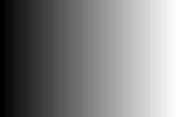
<br>
<i>Version générée</i>
</div>

Ici l'image a été entièrement générée.\
Le pixel tout à gauche est noir, celui tout à droite est blanc.\
On divise la teinte blanche (1) par la longueur de l'image (300 ici), on obtient une valeur.\
Cela donne un calcul du type : `nuance_gris = valeur * x`, où quand x = 0, c'est noir, et quand x = longueur (donc 300), c'est blanc.\
On donne la même nuance de gris à toute la colonne, et on change automatiquement à chaque déplacement sur l'axe x puisque nous suivons la boucle imbriquée.
<br><br><br>

### <a id="p6"></a> 6. Miroir
<div align="center">


<br>
<i>Image originale et version modifiée</i>
</div>

Le pixel tout à gauche devient le pixel tout à droite et ainsi de suite.
<br><br><br>

### <a id="p7"></a> 7. Image bruitée
<div align="center">

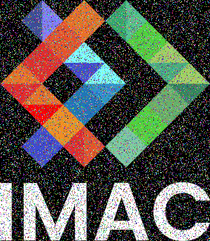
<br>
<i>Image originale et version modifiée</i>
</div>

Lorsque nous parcourons l'image, nous avons 25 % de chance que le pixel soit modifié (bruité).\
Lorsqu'il est décidé que ce pixel est bruité, on récupère une valeur aléatoire que nous donnons aux teintes rouge, vert et bleu.\
\
Nous utilisons un seed afin qu'à chaque lancement du programme, nous obtenions la même suite aléatoire et donc le même résultat que sur l'image juste au-dessus (version modifiée).

<br><br><br>

### <a id="p8"></a> 8. Rotation à 90°
<div align="center">


<br>
<i>Image originale et version modifiée</i>
</div>

On crée un fond noir avec la largeur et la longueur de l'image, mais retourné.\
Cela signifie donc que x sur l'image équivaut à y pour le fond (la valeur x devient la valeur y).\
Pour renverser l'image, y sur l'image doit devenir x sur le fond mais sous la forme `x = image.width() - y - 1`.

<br><br><br>

### <a id="p9"></a> 9. RGB split
<div align="center">

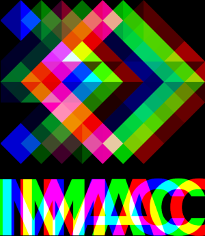
<br>
<i>Image originale et version modifiée</i>
</div>

Pour illustrer : nous sommes sur un logiciel graphique comme Paint.NET.\
Chaque couleur est un calque. On décide de décaler le calque bleu de 30 pixels sur la gauche, le calque rouge de 30 pixels sur la droite.\
En faisant cela, nous obtenons la version modifiée affichée dans ce rapport.\
\
Il suffit juste de créer une nouvelle image (noir) et de placer, de manière décalée comme décrit, le pixel récupéré sur l'image d'origine.

<br><br><br>

### <a id="p10"></a> 10. Luminosité

#### <a id="p10-1"></a> 10.1 Éclaircissement
<div align="center">


<br>
<i>Image originale et version modifiée</i>
</div>

On décrémente la valeur de chaque canal de couleur.

<br><br>

#### <a id="p10-2"></a> 10.2 Assombrissement
<div align="center">


<br>
<i>Image originale et version modifiée</i>
</div>

On incrémente la valeur de chaque canal de couleur.

<br><br><br>

### <a id="p11"></a> 11. Disque
<div align="center">
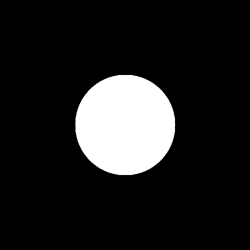
<br>
<i>Image originale et version modifiée</i>
</div>

Je n'ai pas tenu compte de la note concernant la formule pour détecter si un point fait partie du disque ou non.\
À la place, je me suis aidé du cercle trigonométrique et du tableau.\
Je le parcours, puis à chaque ligne (position x sur le cercle), je remplis la ligne de pixels blancs jusqu'à atteindre -x sur le cercle trigonométrique.\
J'incrémente i de 0.00001 afin d'être sûr de passer par un maximum de points sur le cercle trigo pour remplir le disque.

<div align="center">
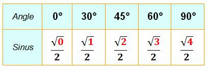
<br>
<i>Tableau trigonométrique, ici seule la fonction Sinus est illustrée</i>
</div>

```c++
for (float i = 0; i <= 4; i += 0.0001)
{
// à chaque point sur l'arc de cercle
float y = (sqrt(i) / 2) * taille; // correspond à sin
float x = (sqrt(4 - i) / 2) * taille; // correspond à cos
```
<div align="center">
<i>Extrait de mon code</i>
</div>

En comparant le code avec le tableau, nous faisons immédiatement le lien entre la boucle et la valeur en rouge sur le tableau (0, 1, 2, 3, 4)
et le calcul de y et x. `taille` indique la taille du disque, et on multiplie la taille avec le calcul afin d'espacer
les points sur le fond noir (vu que la valeur de x et y sera plus grande).

<br><br><br>

### <a id="p12"></a> 12. Cercle
<div align="center">

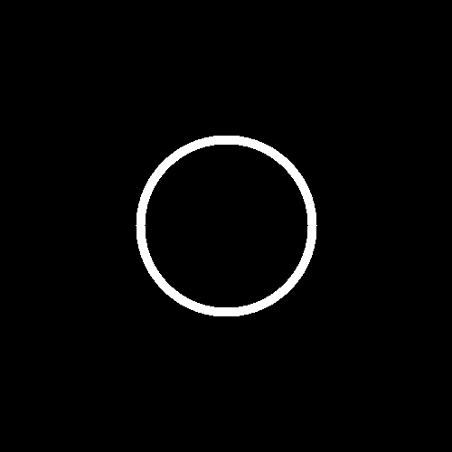
<br>
<i>Image originale et version modifiée</i>
</div>

Je réutilise le cercle trigonométrique mais en utilisant les fonctions sin() et cos().\
Pour l'épaisseur, je trace autant de cercles côte à côte que nécessaire (donc 10 si l'épaisseur est de 10).

<br><br><br>

### <a id="p13"></a> 13. Animation
<div align="center">

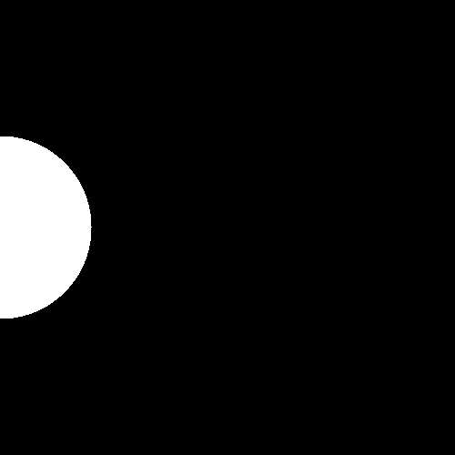
<br>
<i>Image originale et version modifiée</i>
</div>

J'ai fait une boucle où je dessine un disque en changeant la position du centre, puis en rafraîchissant le fond noir.\
J'enregistre ensuite toutes les images générées et j'ai utilisé un site pour en faire un GIF.\
J'ai été contraint de corriger ma fonction disque : je ne gérais pas le cas où mon disque débordait de la zone de dessin. De ce fait, le programme plantait, car les coordonnées étaient inatteignables.

<br><br><br>

### <a id="p14"></a> 14. Rosace
<div align="center">

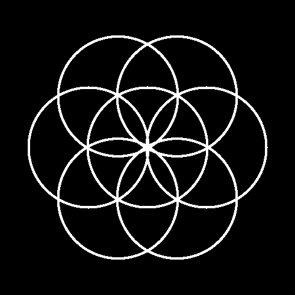
<br>
<i>Image originale et version modifiée</i>
</div>

On trace un cercle central, puis on tourne autour grâce au cercle trigonométrique (on va de 0 à PI*2 avec un pas de PI/3).\
À chaque itération, on redessine le même cercle, mais où le centre de ce nouveau cercle correspond au point sur le cercle central.\
Plus le pas sera petit, plus il y aura de cercles autour du cercle central.

<br><br><br>

### <a id="p15"></a> 15. Mosaïque
<div align="center">

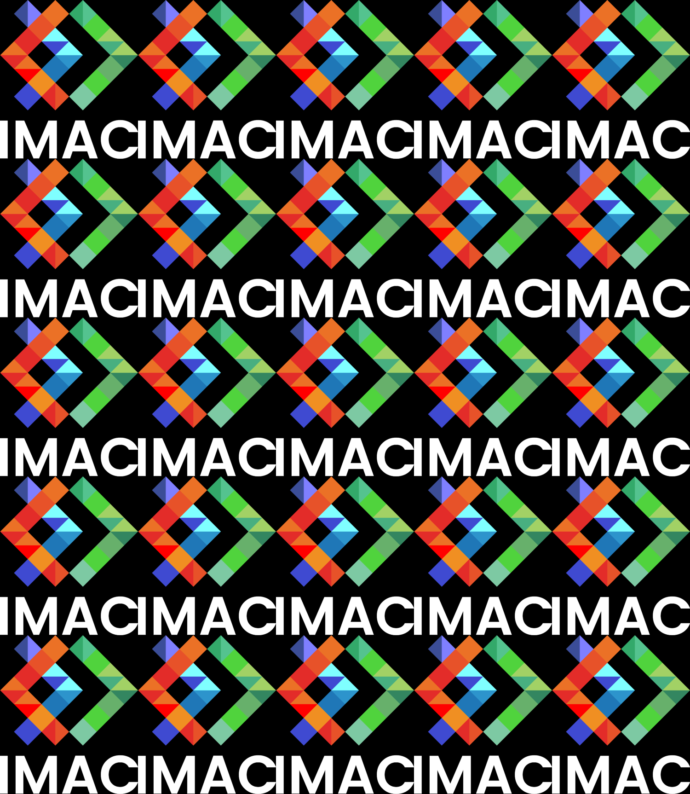
<br>
<i>Image originale et version modifiée</i>
</div>

J'ai créé une nouvelle image : un fond noir 5 fois plus grand que l'image importée afin qu'elle puisse rentrer
25 fois sur le fond.\
J'ai parcouru le fond, et à chaque fois, recopié chaque pixel du logo sur le fond.

<br><br><br>

### <a id="p16"></a> 16. Mosaïque miroir
<div align="center">

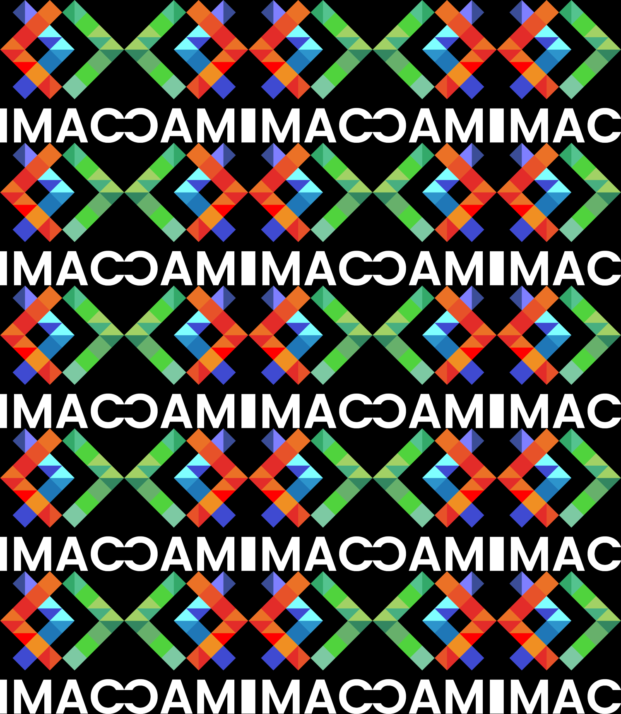
<br>
<i>Image originale et version modifiée</i>
</div>

Il suffit de reprendre le code de la version précédente de mosaïque, et quand nous sommes sur une colonne
impaire, faire appel à la fonction de l'exercice 6 (Miroir). 

<br><br><br>

### <a id="p17"></a> 17. Glitch
<div align="center">


<br>
<i>Image originale et version modifiée</i>
</div>

Voici l'algorithme suivi :
1. On choisit une position aléatoire sur l'image.
2. On choisit une autre position aléatoire sur l'image.
3. On choisit les dimensions d'un rectangle de manière aléatoire.
4. On parcourt une boucle imbriquée longueur x largeur à l'aide du rectangle.
5. On échange chaque pixel entre les deux positions.

<br><br><br>

### <a id="p18"></a> 18. Tri de pixels
<div align="center">

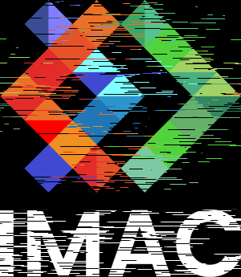
<br>
<i>Image originale et version modifiée</i>
</div>

Sur chaque ligne de l'image, on prend un point aléatoire et une distance aléatoire.\
On trie sur le critère de brightness les pixels sur la distance à partir du point choisi.\
Pour que l'effet soit plus marquant, je choisis en réalité deux points par ligne.

<br><br><br>

### <a id="p19"></a> 19. Fractal de Mandelbrot
<div align="center">

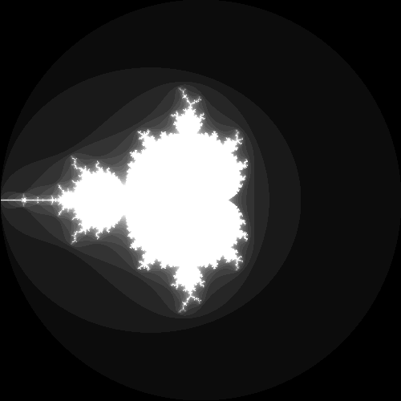
<br>
<i>Image originale et version modifiée</i>
</div>

Une fractale qui était horrible à faire.

<br><br><br>

### <a id="p20"></a> 20. Dégradés dans l'espace de couleur OKLAB
<div align="center">
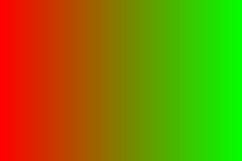
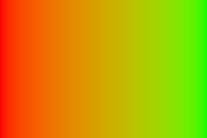
<br>
<i>Image originale et version finale</i>
</div>

Notre dégradé de couleur (image originale) est représenté au format sRGB lorsque nous visualisons l'image.\
De ce fait, les couleurs ne sont pas très belles. Notre objectif est donc de la mettre dans le format de couleur OKLAB, bien plus joli.\
Seulement, nous devons la remettre au format sRGB à la fin, afin qu'elle soit correctement interprétée.
Je me suis aidé des articles partagés dans l'énoncé.\
\
Voici les étapes à suivre :
1. Conversion sRGB -> Linear RGB
2. Conversion Linear RGB -> OKLAB
3. On fait un mix des couleurs rouge et vert en fonction de x
4. Conversion OKLAB -> Linear RGB
5. Conversion Linear RGB -> sRGB

<div align="center">

<br>
<i>Rendu après l'étape 2</i><br>

<br>
<i>Rendu après l'étape 3</i>
</div>

<br><br><br>

### <a id="p21"></a> 21. Tramage
<div align="center">


<br>
<i>Image originale et version modifiée</i>
</div>

Nous voulons représenter de manière jolie notre image avec uniquement du noir et du blanc.\
L'algorithme va jouer sur la présence du noir et du blanc pour faire paraître une nuance de gris.\
C'était utilisé dans le cas des écrans monochromes ou quand nous étions limités en termes de palette de couleurs,
mais également pour les imprimantes à l'époque.\
\
J'ai repris l'algorithme présenté dans l'article de l'énoncé.

### <a id="p22"></a> 22. Normalisation de l’histogramme
<div align="center">


<br>
<i>Image originale et version modifiée</i>
</div>

Lorem ipsum dolor sit amet, consectetur adipiscing elit.  
Sed do eiusmod tempor incididunt ut labore et dolore magna aliqua.  
Ut enim ad minim veniam, quis nostrud exercitation ullamco laboris.

<br><br><br>

### <a id="p23"></a> 23. Distorsion radiale
<div align="center">

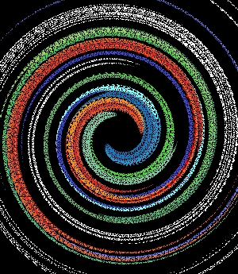
<br>
<i>Image originale et version modifiée</i>
</div>

Lorem ipsum dolor sit amet, consectetur adipiscing elit.  
Integer nec odio. Praesent libero. Sed cursus ante dapibus diam.  
Sed nisi. Nulla quis sem at nibh elementum imperdiet.

<br><br><br>

### <a id="p24"></a> 24. Convolution

L'objectif est de créer un algorithme qui prend en entrée une matrice qui, en fonction de ses valeurs,
provoque des effets particuliers sur l'image.

<br><br>

#### Box Blur
<div align="center">


<br>
<i>Image originale et version modifiée</i>
</div>

On rend flou l'image (ici, un flou léger, la matrice fait du 10x10, donc le pixel est la moyenne des 99 pixels autour de lui).

<br><br>

#### Emboss
<div align="center">


<br>
<i>Image originale et version modifiée</i>
</div>

Un sorte de mini effet 3D si on peut dire (on dirait que le logo ressort, comme s'il y avait de l'ombre, comme
si le logo était sur une bosse). Utilisation de https://en.wikipedia.org/wiki/Image_embossing pour récupérer la matrice. 

<br><br>

#### Outline
<div align="center">

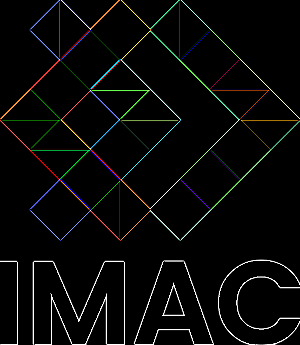
<br>
<i>Image originale et version modifiée</i>
</div>

On souhaite conserver uniquement les contours, utilisation de https://docs.gimp.org/2.6/fr/plug-in-convmatrix.html

<br><br>

#### Sharpen
<div align="center">


<br>
<i>Image originale et version modifiée</i>
</div>

On souhaite améliorer la netteté de l'image, utilisation de https://fr.wikipedia.org/wiki/Noyau_(traitement_d%27image)

<br><br><br>

### <a id="p25"></a> 25. Filtres séparables
<div align="center">
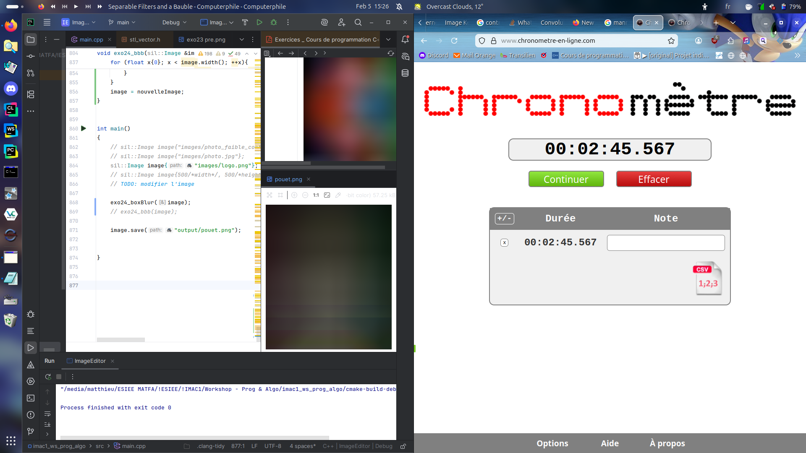<br>
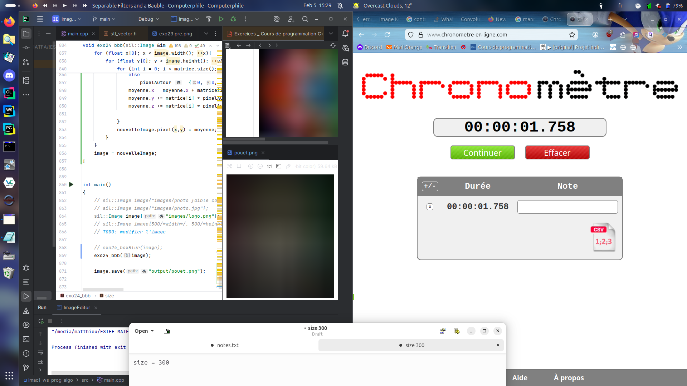
<br>
<i>Comparaison (voir explications)</i>
</div>

Plutôt que de parcourir la matrice entièrement pour chaque pixel de l'image,
on analyse dans un premier temps l'image à l'horizontal puis à la verticale.\
On fait le mélange uniquement sur les pixels horizontaux quand on parcourt à l'horizontal
(et donc verticaux quand on parcourt à la verticale).\
On remarque que la première méthode prend beaucoup plus de temps que la méthode 2.\
\
Remarque : le temps varie en fonction de l'intensité du flou et de la configuration matérielle.\
\
**Voici les informations lors de l'exécution de ce test :**\
Intensité indiquée : 300\
Configuration Matérielle :
- Processeur : AMD Ryzen 5 7535HS
- Mémoire RAM : 16Go
- OS : Ubuntu 24.04.3 64bits (Linux 6.14.0-37-generic)
- Modèle PC : Acer Nitro ANV15-41
<br><br><br>

### <a id="p26"></a> 26. Détection de contours
<div align="center">

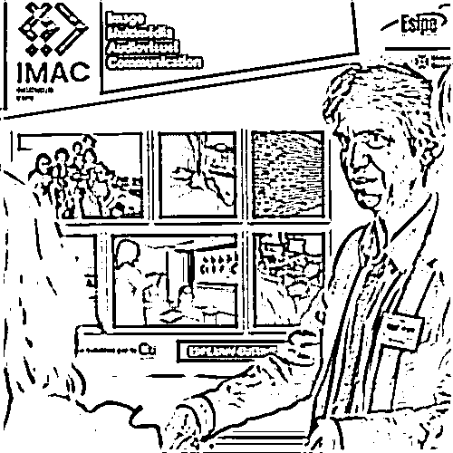
<br>
<i>Image originale et version modifiée</i>
</div>

J'ai fait une détection des contours mais malheureusement, ça ne correspond pas à l'image de l'énoncé.

<br><br><br>
